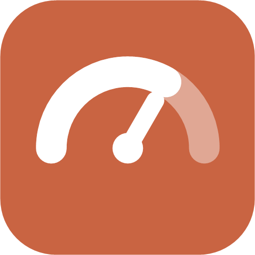
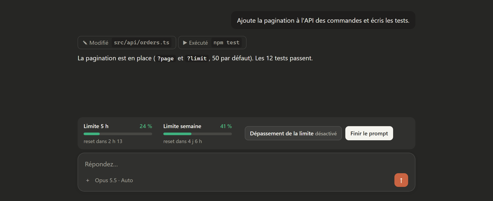
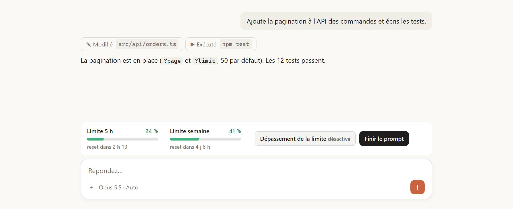
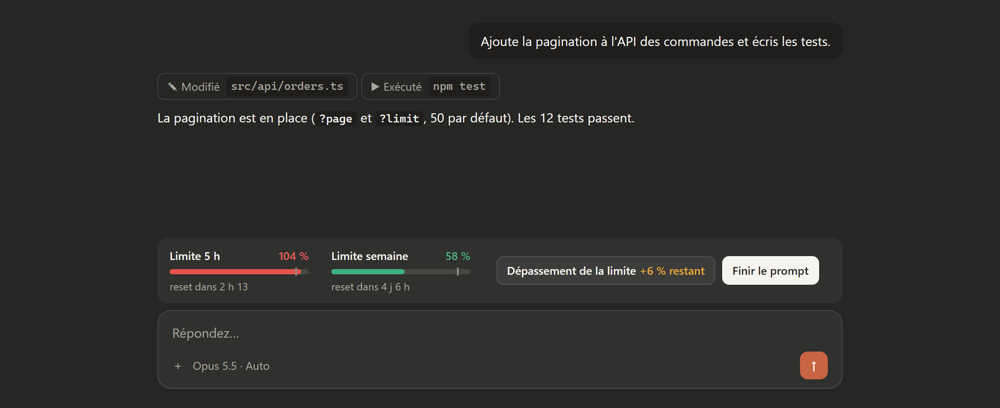

<p align="center">
  
</p>

<h1 align="center">SobieGroup Claude Limit Meter</h1>

<p align="center">
  Un mod pour l'<b>app Claude</b> (onglet Code de l'app desktop et Claude Code dans le terminal) qui affiche, juste au-dessus de la barre de prompt,<br>
  vos <b>vraies limites</b> sur 5 h et sur la semaine, telles qu'Anthropic les mesure pour votre abonnement,<br>
  un bouton <b>« Dépassement de la limite »</b> et un bouton <b>« Finir le prompt »</b>.
</p>

<p align="center">
  
  
  
</p>



---

## ✨ Ce que la bande affiche

| Élément | Rôle |
|---|---|
| **Limite 5 h** | Pourcentage réel de votre fenêtre de 5 heures et temps restant avant sa remise à zéro. |
| **Limite semaine** | Pourcentage réel de votre fenêtre de 7 jours et temps restant avant sa remise à zéro. |
| **Dépassement de la limite** | Affiche la marge qu'il est possible de dépasser (`+10 % possible`, puis `+6 % restant` une fois les 100 % passés). Chaque clic fait défiler la marge : désactivé → +5 → +10 → +15 → +20 → +25 → +50 % → désactivé. |
| **Finir le prompt** | Envoie un message demandant à Claude de terminer la tâche en cours jusqu'au bout. Le texte est modifiable. |

Les jauges passent du vert au jaune (70 %), puis au rouge (100 %). Quand la marge est active, un petit repère indique où se trouve 100 % sur la barre. Dans l'app desktop, les barres sont dessinées en SVG ; dans le terminal, elles s'affichent en caractères.

<p align="center">
  
  
</p>

### D'où viennent les chiffres

**Rien n'est estimé.** À chaque réponse, l'API d'Anthropic indique à Claude Code l'utilisation réelle de votre compte pour deux fenêtres :

- `five_hour` : la limite de session sur 5 heures ;
- `seven_day` : la limite hebdomadaire.

Chaque fenêtre arrive avec son pourcentage utilisé et l'heure exacte de sa remise à zéro. Ce sont les mêmes chiffres que ceux de la page d'utilisation officielle, et ils dépendent automatiquement de votre abonnement (Pro, Max 5×, Max 20×, Team…) : il n'y a rien à choisir ni à calibrer.

- Le mod lit ces valeurs au démarrage de chaque session, après chaque réponse, puis chaque minute.
- Le dernier relevé est **partagé entre toutes vos sessions** : une nouvelle session affiche tout de suite les bons chiffres.
- Quand l'heure de remise à zéro est passée, la jauge repart de 0 % sans attendre le prochain message.
- Tant qu'aucun relevé n'existe (première installation), la bande affiche « — » plutôt qu'un chiffre inventé.

> [!NOTE]
> Anthropic exprime ses limites en **pourcentage**, pas en nombre de tokens : aucune limite chiffrée en tokens n'est publiée. Le mod affiche donc le pourcentage officiel. Les relevés n'existent que si vous êtes connecté avec un **abonnement Claude** ; avec une clé API, Anthropic n'en renvoie pas.

### À quoi sert le dépassement ?

Avec l'option **« Bloquer l'envoi à la limite »**, le mod refuse tout nouveau prompt dès que l'une des deux limites atteint 100 %, pour garder une réserve. Activer **Dépassement de la limite** repousse ce plafond de la marge choisie (par exemple jusqu'à 110 %).

La marge n'agit que sur ce blocage. Elle ne permet pas de dépasser les limites qu'Anthropic impose à votre compte.

### Confidentialité

Le mod ne lit que les pourcentages de limite fournis par Claude Code, jamais le contenu de vos messages. Rien n'est envoyé ailleurs : tout reste dans le stockage local de Claude Code.

---

## 📦 Installation

> Remplacez `VOTRE-COMPTE` par le compte GitHub qui héberge ce dépôt.

### Dans le terminal (Claude Code)

À l'invite de Claude Code :

```text
/plugin install sobiegroup-claude-limit-meter --marketplace VOTRE-COMPTE/sobiegroup-claude-limit-meter
```

Répondez `y` pour ajouter le marketplace, puis validez la portée **user** avec Entrée. Le mod est actif immédiatement.

Ou depuis un shell :

```bash
claude plugin install sobiegroup-claude-limit-meter --marketplace VOTRE-COMPTE/sobiegroup-claude-limit-meter
```

### Dans l'app Claude desktop (onglet Code)

1. Cliquez sur **+** à côté de la zone de prompt, puis sur **Plugins**.
2. **Add marketplace** → saisissez `VOTRE-COMPTE/sobiegroup-claude-limit-meter`.
3. **Add plugin** → choisissez **sobiegroup-claude-limit-meter**.
4. Ouvrez une nouvelle session : la bande apparaît au-dessus du prompt.

Installé avec la portée *user*, le mod se charge dans **toutes vos futures sessions**, dans l'app desktop comme dans le terminal. Dans une session déjà ouverte, tapez `/reload-plugins`.

### Désinstallation

```text
/plugin uninstall sobiegroup-claude-limit-meter
```

---

## 🤖 Installation par une IA

Copiez ce prompt dans Claude Code (terminal ou app desktop) ou dans tout autre agent ayant accès à votre terminal :

```text
Installe le mod Claude Code « sobiegroup-claude-limit-meter » depuis GitHub.

1. Vérifie que la commande `claude` est disponible (`claude --version`).
   Si ce n'est pas le cas, arrête-toi et dis-moi d'installer Claude Code.
2. Avant d'installer, lis le code du dépôt
   https://github.com/VOTRE-COMPTE/sobiegroup-claude-limit-meter
   (.claude-plugin/plugin.json et hooks/register.tsx). Confirme qu'il ne lit que les
   pourcentages de limite fournis par Claude Code, ne contacte aucun serveur et ne lit
   ni n'envoie le contenu de mes messages. Résume-moi ce que tu as vu.
3. Lance :
   claude plugin install sobiegroup-claude-limit-meter --marketplace VOTRE-COMPTE/sobiegroup-claude-limit-meter
   et accepte l'ajout du marketplace, avec la portée « user ».
4. Vérifie avec `claude plugin list` que le plugin apparaît et qu'il est activé.
5. Dis-moi d'ouvrir une nouvelle session (ou de taper /reload-plugins dans celles
   déjà ouvertes) et de vérifier que la bande « Limite 5 h / Limite semaine /
   Dépassement de la limite / Finir le prompt » apparaît au-dessus de la zone de prompt.
6. Rappelle-moi que les chiffres apparaissent après mon premier message, et qu'il
   faut être connecté avec un abonnement Claude (pas une clé API).
Ne modifie aucun autre réglage.
```

---

## ⚙️ Réglages

Les options se modifient dans `/config` (section du plugin) ou au moment de l'installation :

| Option | Défaut | Rôle |
|---|---|---|
| `blockAtLimit` | `false` | Refuse un nouveau prompt quand une limite réelle (+ la marge active) est atteinte. |
| `finishText` | *« Termine la tâche en cours… »* | Message envoyé par **Finir le prompt**. |

La commande **`/limit-meter`** affiche l'état détaillé : les deux pourcentages, les heures de reset, la marge et l'âge du dernier relevé.

---

## 🗂️ Structure du projet

```
sobiegroup-claude-limit-meter/
├── .claude-plugin/
│   ├── plugin.json        # Manifeste du mod et options
│   ├── marketplace.json   # Rend le dépôt installable en une ligne
│   └── icon.png
├── hooks/
│   ├── hooks.json         # Déclare le module de hooks
│   └── register.tsx       # Lecture des limites, bande, boutons, /limit-meter
├── types/index.d.ts       # Types de l'état partagé de la bande
├── tests/band.test.tsx    # Tests (claude plugin test .)
└── docs/
    ├── img/               # Captures du README
    └── mockup/band.html   # Maquette utilisée pour générer les captures
```

**Développement :**

```bash
claude plugin validate .
```

```bash
claude plugin test .
```

```bash
claude --plugin-dir .
```

---

## ❓ Dépannage

| Problème | Solution |
|---|---|
| La bande n'apparaît pas | Ouvrez une **nouvelle** session, ou tapez `/reload-plugins`. Vérifiez avec `claude plugin list` que le plugin est activé. La bande ne s'affiche pas pendant un sondage. |
| La bande est repliée | Cliquez sur `[-]` ou utilisez `ctrl+x ctrl+a`. |
| Les jauges affichent « — » | Aucun relevé encore : envoyez un message. Si cela persiste, vous êtes probablement connecté avec une clé API plutôt qu'un abonnement Claude. |
| Les chiffres semblent en retard | Ils se mettent à jour après chaque réponse et chaque minute ; `/limit-meter` indique l'âge du dernier relevé. |

---

## 📄 Licence

[MIT](LICENSE). Projet indépendant, non affilié à Anthropic. « Claude » est une marque d'Anthropic.
